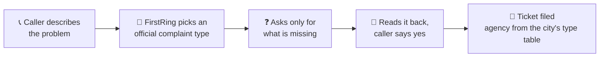
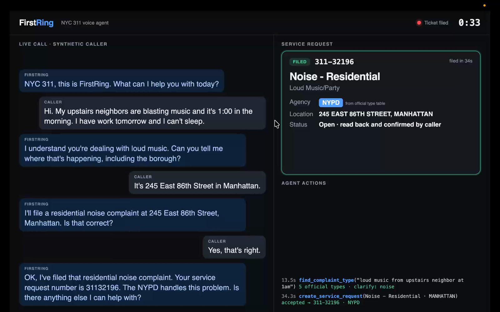
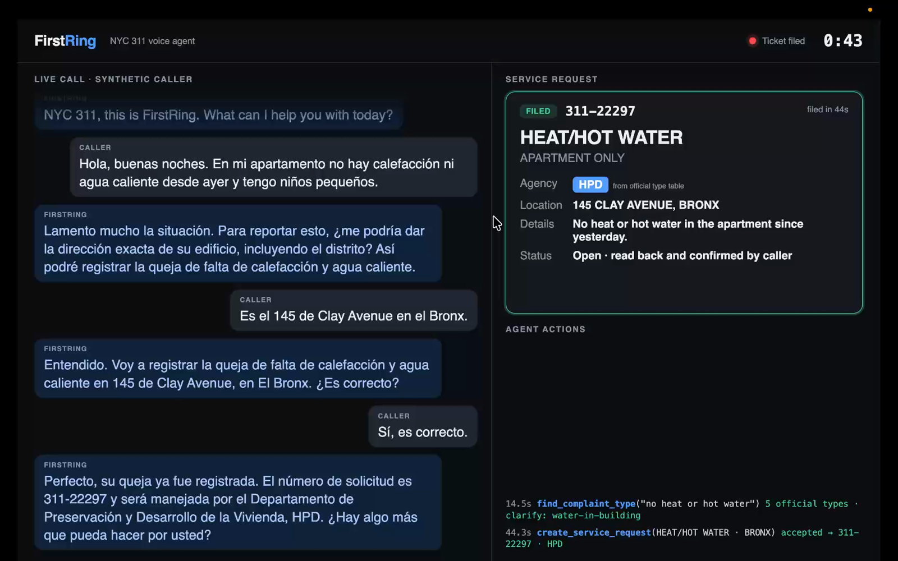
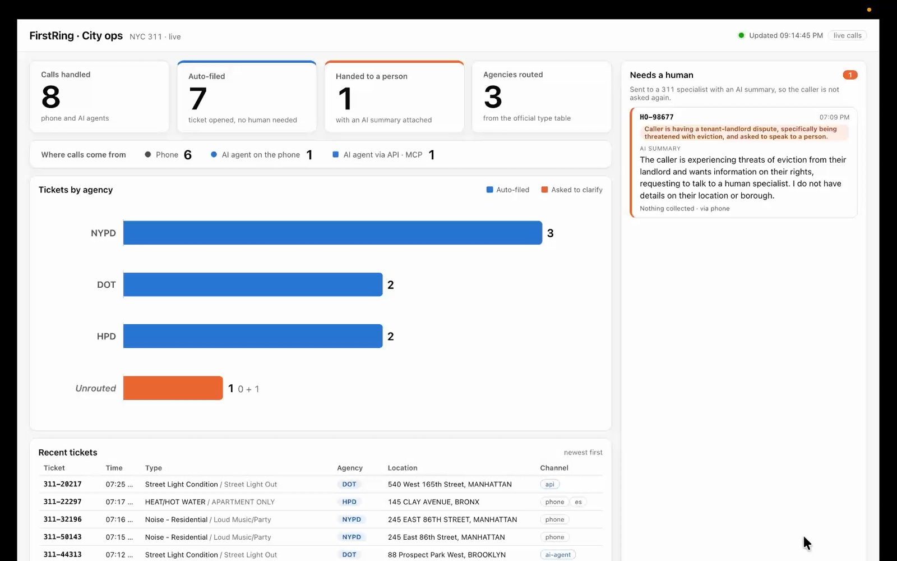
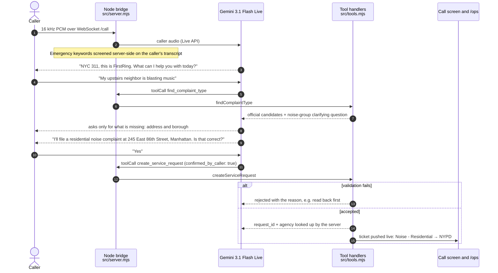
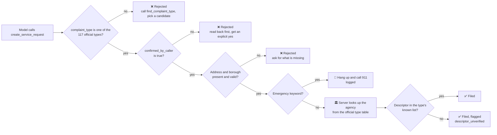
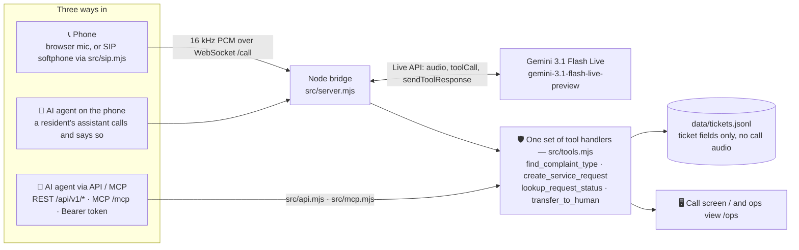
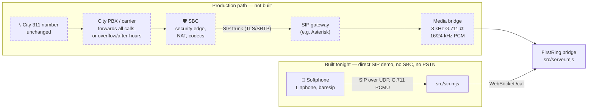

# FirstRing

**Every 311 call becomes a complete, correctly routed ticket — before the caller hangs up.**



FirstRing is a voice agent for New York City's 311 line. It answers immediately, works out which of the city's official complaint types the caller means, asks only for what is missing, reads the request back, and files a ticket whose agency comes from the city's own type table, not from the model.

Demo video (74 s): https://youtu.be/BRY_yJmX15A



| Spanish call, English ticket (HEAT/HOT WATER → HPD) | City ops view: every ticket, by agency and channel |
|---|---|
|  |  |

*Screenshots from recorded demo calls with synthetic callers.*

Built during the c0mpiled-18 hackathon (Taipei, 2026-11-11).

- **🎯 No made-up categories.** `complaint_type` is an enum of 117 official NYC types; the model cannot write free text.
- **🏛️ The server routes, not the model.** The agency is looked up from the official type table.
- **🔁 No ticket without a read-back.** The server rejects a request until the caller has confirmed it.
- **🚨 Emergencies go to 911.** Emergency keywords are caught server-side and answered with "hang up and call 911".
- **🔌 Three ways in, one set of rules.** Phone calls, a resident's AI assistant on the phone, and AI agents over REST/MCP all go through the same tool handlers.

**Contents:** [Call it yourself](#call-it-yourself-judges-try-it-from-your-phone) · [What happens on one call](#what-happens-on-one-call) · [How it avoids misclassifying](#how-it-avoids-misclassifying) · [Architecture](#architecture) · [The problem](#the-problem) · [Business model](#business-model) · [Going live tomorrow](#going-live-tomorrow) · [Run it locally](#run-it-locally)

---

## Call it yourself (judges: try it from your phone)

FirstRing answers a real SIP call from a free softphone app — no browser needed.

1. Install **Linphone** (free, [iOS](https://apps.apple.com/app/linphone/id360065638) / [Android](https://play.google.com/store/apps/details?id=org.linphone) / [desktop](https://www.linphone.org/)).
2. Join the same network as the demo laptop (we'll share our hotspot at the table — the laptop is not reachable from the public internet).
3. In Linphone: *Use a SIP account* → username: anything (e.g. `judge`), password: blank, domain: **the laptop IP we give you, with `:5070`** (e.g. `172.20.10.3:5070`), transport **UDP**.
4. Dial **`311`** and report a problem in English or Spanish — e.g. *"My upstairs neighbor is blasting music"* — then give an address and borough, and say yes to the read-back.
5. Watch the ticket appear live on the ops view (`/ops`).

> [!TIP]
> Use earphones or turn speakerphone off: the agent's own voice played over a loudspeaker can be picked up as the caller.

This is a direct SIP demo (G.711 over UDP, no SBC, no phone number) — see [Connecting to a real 311 phone line](#connecting-to-a-real-311-phone-line-not-built-tonight).

## What happens on one call

A synthetic caller (pre-recorded TTS audio, played as the microphone) reports loud music upstairs:



1. FirstRing answers: *"NYC 311, this is FirstRing. What can I help you with today?"*
2. Caller describes the problem. The agent calls `find_complaint_type`, which returns official candidates (plus a clarifying question when they fall in a confusable group like noise).
3. The agent asks only for what is missing — the address and borough.
4. It reads back: *"I'll file a residential noise complaint at 245 East 86th Street, Manhattan. Is that correct?"*
5. Caller says yes. `create_service_request` is accepted by the server; the ticket appears on screen — **Noise - Residential / Loud Music/Party → NYPD** — about 35 seconds after the call started (measured on our recorded demo calls).

The same flow works in Spanish and when the caller is a resident's AI assistant:

| Demo call | Caller | Ticket |
|---|---|---|
| 🇺🇸 Noise | English | **Noise - Residential / Loud Music/Party → NYPD** |
| 🇪🇸 Heat | Spanish conversation, English ticket | **HEAT/HOT WATER → HPD** |
| 🤖 Streetlight | A resident's AI assistant | **Street Light Condition → DOT**, filed `on_behalf_of` the resident |

**When a person is needed.** When the caller asks for a person, the problem isn't an official type, or the agent is still unsure after clarifying twice, it calls `transfer_to_human`: the call screen shows *Transferring to 311 specialist* and a handoff record with an AI-written summary lands in the ops view's **Needs a human** list, so the specialist doesn't make the caller repeat themselves.

## How it avoids misclassifying

Accuracy comes from giving the model no room to make things up, not from asking it to be careful. Every `create_service_request` passes the same server-side checks:



Every rejection goes back to the model with the reason, so it fixes the request on the same call instead of filing a wrong one.

| Guardrail | Where |
|---|---|
| `complaint_type` is a JSON-schema **enum of 117 official NYC types**; free text is impossible | `src/tools.mjs` `LIVE_TOOLS` |
| **Agency is looked up by the server** from the official type table and returned to the model — the model never names an agency on its own (in earlier tests it invented one) | `createServiceRequest` |
| `confirmed_by_caller` must be `true` or the server **rejects the request** and tells the model to read back first. In our AI-assistant demo call the model tried to file without a read-back, got rejected, read back, then filed | `createServiceRequest` |
| `find_complaint_type` returns official definitions and, for 10 confusable groups (noise, vehicles, parking, water, pests, …), the group's clarifying question and decision rule | `findComplaintType`, `data/nyc_confusables.json` |
| Descriptors outside the type's known list are kept but flagged `descriptor_unverified` instead of blocking the call | `createServiceRequest` |
| Emergency keywords (fire, gas leak, not breathing, gun, …) are caught **server-side** on the caller's transcript and on every API request, answered with "hang up and call 911", and logged | `detectEmergency` |

## Architecture

### Three ways in, one set of rules



| Channel | How | Ticket `channel` |
|---|---|---|
| Phone | Voice call (browser today; SIP in production, see below) | `phone` |
| AI agent on the phone | A resident's AI assistant calls and says so; served the same way, still has to confirm the read-back | `ai-agent` |
| AI agent via API / MCP | `POST /api/v1/requests` or the MCP tools — same enum, same agency lookup, `confirmed_by_resident` required | `api` |

```bash
# REST
curl -H "Authorization: Bearer $FIRSTRING_API_TOKEN" "localhost:8080/api/v1/complaint-types?q=streetlight+out"
curl -H "Authorization: Bearer $FIRSTRING_API_TOKEN" -H "content-type: application/json" \
  -d '{"complaint_type":"Street Light Condition","descriptor":"Street Light Out","location":"540 West 165th Street","borough":"MANHATTAN","on_behalf_of":"Maria Lopez","confirmed_by_resident":true}' \
  localhost:8080/api/v1/requests
# MCP (Streamable HTTP at /mcp): find_complaint_type, create_service_request, lookup_request_status
FIRSTRING_API_TOKEN=... node scripts/agent-demo.mjs          # MCP client acting as a resident's assistant
FIRSTRING_API_TOKEN=... node scripts/agent-demo.mjs --rest   # same flow over REST
```

### Where things live

| Path | What it does |
|---|---|
| `src/server.mjs` | Node bridge (express + ws): WebSocket `/call` ⇄ Gemini Live, pushes tickets to `/` and `/ops` |
| `src/tools.mjs` | The 4 tool handlers and all validation — shared by every entry point |
| `src/api.mjs` | REST API `/api/v1/*` |
| `src/mcp.mjs` | MCP server (Streamable HTTP at `/mcp`) |
| `src/sip.mjs` | SIP softphone demo endpoint |
| `public/index.html` | Call screen |
| `public/ops.html` | City ops view |
| `scripts/agent-demo.mjs` | Demo client acting as a resident's AI assistant (MCP or REST) |
| `data/` | Official type table, confusable groups, synthetic caller audio, ticket log |

## The problem

- 📈 NYC 311 took **16.6 million calls** in FY2026; the average wait was **43 seconds** against a 30-second target, and 75% were answered within 30 seconds against an 80% target. ([Mayor's Management Report FY2026, 311 chapter](https://www.nyc.gov/assets/operations/downloads/pdf/mmr2026/311.pdf))
- 🗂️ Turning a call into a ticket means choosing among 100+ official complaint types and getting an exact address — on the phone, in the caller's language. About **1.7 million** of those calls a year are in Spanish (same report).

## Business model

- 💵 Cities pay **$1 per resolved call** (a call the AI finished without a human).
- 🧾 Today each 311 call costs at most about **$3.87** ($64.2M total 311 spend ÷ 16.6M calls; the spend also covers web and app, so the real per-call cost is lower).
- 📊 If FirstRing resolves **30% of NYC calls (an assumption, not measured)**: about **$5M/year** revenue, and the city saves roughly $14M/year.
- 🪜 Rollout: overflow and after-hours first (no existing jobs displaced), then the main line, then permits and inspections.

## Going live tomorrow

What is done tonight, and what a real deployment still needs — honestly:

| Area | Done tonight | Still needed |
|---|---|---|
| Classification & routing | 117-type enum, server-side agency lookup, read-back required, confusable-group questions | Validate on real (non-synthetic) call recordings; per-borough agency exceptions |
| Telephony | Browser voice calls | **SIP**: the city forwards its number (or just overflow/after-hours) to a cloud SIP gateway. We have pilot-tested a SIP-to-AI voice bridge separately; it is **not connected to FirstRing yet** and has never been tested with a real phone number |
| Handoff to a person | `transfer_to_human` creates a handoff record with an AI summary, shown in the ops view | **SIP REFER** into the city's existing specialist queue, with the summary attached to the call |
| City systems | Tickets in an append-only JSONL log | Integration with the city's 311 CRM so tickets get real SR numbers and status updates |
| Security | Bearer token required on API and MCP (refused when unset); emergency screen on server; concurrency, idle and max-length limits per call | City SSO for the ops view; rate limiting per API client; token rotation |
| Data retention | No call audio stored; only ticket fields | A written retention policy agreed with the city (how long transcripts/ticket fields are kept, who can see them) |
| Ops | `npm start` one-command start | Monitoring, alerting, multi-region failover |

### Connecting to a real 311 phone line (not built tonight)

Tonight's calls run over the browser. Answering a city's existing number needs a telephony path in front of the same bridge — none of the dashed part is implemented in this repo:



1. **Number stays the same.** The city (or its carrier) forwards calls to us — all of them, or only overflow and after-hours, which is the easiest first step.
2. **SBC (session border controller)** at the edge: authenticates the trunk, handles NAT, encryption (TLS/SRTP) and codec negotiation.
3. **SIP gateway + media bridge**: terminates SIP/RTP and converts 8 kHz telephone audio to the 16 kHz PCM this bridge already accepts, and the agent's 24 kHz audio back to 8 kHz. The bridge's WebSocket protocol does not change.
4. **Handoff**: `transfer_to_human` becomes a SIP REFER (or a PBX transfer) into the city's existing specialist queue, with the AI summary attached via the CRM or a SIP header.
5. **Status**: we have pilot-tested a SIP-to-AI voice bridge separately (SIP softphone → cloud Asterisk → voice AI). That pilot has **never been connected to a real phone number (PSTN) or an SBC.** Tonight we added a minimal SIP endpoint directly to FirstRing (next section), also without an SBC or PSTN.

#### SIP softphone demo (built tonight)

`src/sip.mjs` is a minimal SIP endpoint so a softphone (Linphone, baresip) on the same network can call FirstRing directly. It is a demo, not a telephony stack:

- Direct SIP over UDP to this machine. No registrar, no authentication, no SBC, no TLS/SRTP, no NAT traversal, no PSTN number.
- One codec only: G.711 PCMU 8 kHz. Audio is converted in-process (8 → 16 kHz up, 24 → 8 kHz down) with no extra dependencies.
- Each SIP call opens a normal WebSocket call on `/call`, so tools, validation, tickets and the ops view are the same as browser calls. Tickets show `source: "sip"`.

```bash
SIP_ENABLED=1 SIP_PORT=5070 npm start
# then dial from a softphone on the same network:
#   sip:311@<this-machine-ip>:5070
```

## Run it locally

Requires Node 20+ and a Gemini API key.

```bash
npm install
export GEMINI_API_KEY=...            # never commit it; .env* is git-ignored
export FIRSTRING_API_TOKEN=change-me # enables the REST API and MCP
npm start                            # http://localhost:8080
```

| URL | What you get |
|---|---|
| `http://localhost:8080/` | Call screen, talk through your mic |
| `http://localhost:8080/?caller=nyc-noise` | Synthetic caller (also `es-heat`, `agent`, `human`) |
| `http://localhost:8080/ops` | City ops view |

## Data

Pre-event prepared **public data** (no product code was written before the event):

- `data/nyc_taxonomy.json` — 117 official complaint types with agency, top descriptors and a one-line definition, from NYC Open Data dataset `erm2-nwe9`
- `data/nyc_confusables.json` — 10 groups of easily confused types with a clarifying question each
- `data/audio/*.wav` — synthetic caller lines for the demo calls (TTS)

All calls shown in the demo video are **synthetic calls**.

## License

MIT, see [LICENSE](LICENSE).
